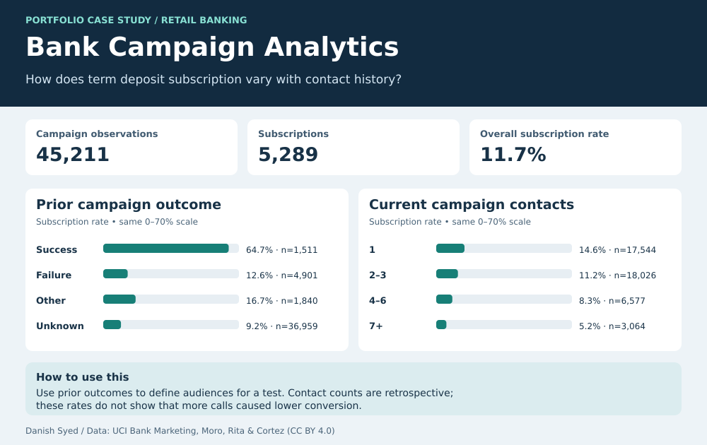

# Bank Campaign Analytics

When a bank plans its next term-deposit campaign, which groups are worth testing first? I used SQL to compare subscription rates by previous campaign outcome and by the number of contacts recorded in the current campaign.

## What the data showed

- **11.70% overall:** 5,289 subscriptions across 45,211 observations. The file has no stable customer ID, so these are observations rather than a count of unique people.
- **64.73% after a prior success** (978 of 1,511), versus **9.16% where the prior outcome was unknown** (3,386 of 36,959). The smaller, higher-rate group is a candidate for a controlled follow-up test.
- **14.60% with one current-campaign contact**, versus **5.25% with seven or more**. Contact count is known after outreach, and harder-to-convert cases may receive more attempts. These historical rates cannot establish the effect of calling again.

## Reproduce the analysis

Run `python3 build.py` from this folder. The script downloads the original UCI archive and reads `bank-full.csv`. If you already have that file, use `python3 build.py --csv /path/to/bank-full.csv`. It uses Python's standard library, runs [the SQLite query](analysis.sql), and regenerates the SVG and [aggregate CSV](campaign_summary.csv). The CSV can also be imported into Tableau or Power BI.

The dashboard and code were built for this portfolio project. The public source is **Bank Marketing**, by S. Moro, P. Rita, and P. Cortez, [UCI Machine Learning Repository](https://archive.ics.uci.edu/dataset/222/bank%2Bmarketing), DOI [10.24432/C5K306](https://doi.org/10.24432/C5K306), licensed [CC BY 4.0](https://creativecommons.org/licenses/by/4.0/). The CSV in this folder is an aggregation of the source. Raw rows are downloaded separately.
