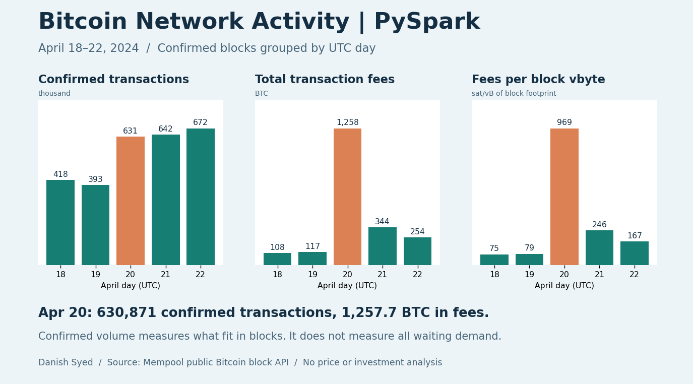

# Bitcoin Network Activity | PySpark

When Bitcoin fees rise, did more transactions get confirmed, or did confirmed block space earn more fees? This case study compares five UTC days around block 840,000 in April 2024.

## What the data showed

- **April 20:** 630,871 confirmed transactions generated **1,257.7 BTC** in fees. Compared with April 19, confirmations increased **61%**, while total fees were **10.8×** higher.
- **Fees per block vbyte** rose from **79 to 969 sat/vB** over the same comparison. The median of the reported block median rates rose from **64.0 to 768.5 sat/vB**.
- **April 22 confirmed more transactions** (671,619) than April 20, but generated only **253.9 BTC** in fees. More confirmations alone did not explain the spike.

The snapshot covers **718 blocks** summarizing **2,755,007 non-coinbase transactions**.

## How the metrics work

- **Confirmed transactions:** sum of the block transaction counts, subtracting one coinbase transaction per block.
- **Transaction fees:** sum of the provider's block fee totals in satoshis, excluding block subsidy. The output also reports BTC and mean satoshis per confirmed transaction.
- **Fees per block vbyte:** total fees divided by total block weight / 4. This is a fee density across the entire confirmed block footprint, including coinbase and overhead. It is not a transaction-weighted median fee rate.
- **Median block fee rate:** median across the provider-reported median fee-rate values for each day's blocks. Each block gets equal weight; the metric is not the median of all individual transactions.

Confirmed transactions measure what miners included. This dataset does not observe pending demand, waiting times, the composition of transactions, or which events caused the fee spike. The analysis describes a five-day historical window, not a current fee estimate.

## Reproduce it

Install Python dependencies with `pip install -r requirements.txt` and run `python build.py` with Java available. The build reads [the fixed block snapshot](blocks.csv), runs [Spark SQL](analysis.sql), and regenerates [daily results](daily_results.csv) and the chart. Run `python validate_results.py` to reconcile the Spark output independently. `python fetch_blocks.py` re-fetches the public snapshot if needed; it checks a padded, contiguous chain by block hash before filtering on UTC timestamps.

Source: [Mempool Bitcoin REST API](https://mempool.space/docs/api/rest), endpoint `/api/v1/blocks/:startHeight`. The CSV contains only public block identifiers, timestamps, and aggregate fields; it has no addresses or individual transaction records. See [block 840,000](https://www.blockchain.com/explorer/blocks/btc/840000) for the historical reference point.
