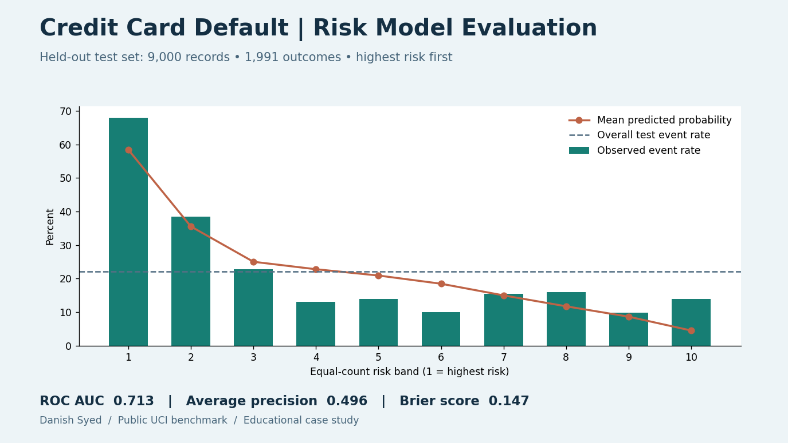

# Credit Card Default | Risk Model Evaluation

Can a model rank next-month default risk, and do its probability estimates agree with what actually happened? This educational project uses a logistic regression baseline on UCI's historical Taiwan credit-card dataset.

- **Test set:** 9,000 accounts and 1,991 next-month defaults (22.1%). ROC AUC was **0.713** and average precision **0.496**.
- **Highest-risk 10%:** 612 of 900 defaulted (68.0%), compared with a mean predicted probability of 58.5%. The band contained 30.7% of all test-set defaults.
- **Probability accuracy:** the Brier score was **0.147**, versus **0.172** for a model that predicts the training-set base rate for every account. The best-ranked band still underpredicted observed defaults by about 9.5 percentage points.

The model uses credit limits, prior repayment status, bills and payment amounts. It excludes account ID and demographic columns. Scaling is fitted only on the training data. The random split is suitable for a benchmark, but it does not establish current, out-of-time performance, subgroup fairness, or suitability for lending decisions.

Run `pip install -r requirements.txt` and `python build.py`. The script downloads the original UCI XLS and reproduces the seeded split, [metrics](metrics.csv), [risk bands](risk_bands.csv), and dashboard. The raw dataset is not copied into the repository.

Data: I-Cheng Yeh, [Default of Credit Card Clients](https://doi.org/10.24432/C55S3H), UCI Machine Learning Repository (2009), [CC BY 4.0](https://creativecommons.org/licenses/by/4.0/).
