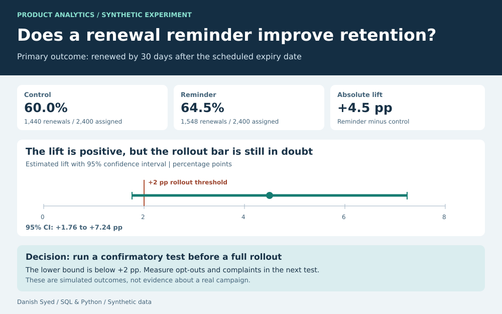

# Customer Retention | A/B Test Analysis

Would a renewal reminder increase the number of subscribers who renew, and would the lift be large enough to justify a rollout? This portfolio example uses synthetic data to show how I'd make that decision.

## Experiment setup

In a live test, randomly assign eligible subscribers 1:1 at the subscriber level before renewal. The control arm receives the usual renewal experience; the treatment arm also receives a reminder seven days before scheduled expiry. Count a renewal if it occurs by 30 days after the scheduled expiry. Wait for every assigned subscriber's follow-up window to close and analyse by assigned group, even if the message wasn't delivered.

For this example, the rollout rule is set in advance: the lower end of the two-sided 95% confidence interval must be at least **+2 percentage points**, and opt-outs and complaints must stay within agreed guardrail limits. The fixture fixes the arm counts and renewal outcomes for demonstration; it does not simulate delivery, guardrails, or an actual campaign.

| Arm | Assigned | Renewed | Renewal rate |
| --- | ---: | ---: | ---: |
| Control | 2,400 | 1,440 | 60.0% |
| Reminder | 2,400 | 1,548 | 64.5% |

**Estimated lift: +4.50 percentage points.** The two-sided 95% confidence interval for the absolute difference is **+1.76 to +7.24 points**, using a large-sample normal approximation with separate arm variances.

## Decision

The interval excludes zero but crosses the +2-point business threshold. I would hold off on a full rollout. For a new, independent confirmatory test, set the sample size and decision rule in advance and track opt-outs and complaints. The synthetic result does not establish that a real reminder campaign will work.

## Reproduce it

Run `python3 build.py`. The script creates a synthetic subscriber-level fixture in SQLite, runs [the SQL](analysis.sql), calculates the confidence interval, and regenerates the dashboard and CSVs. No external dependencies or real subscriber data are used.

[Arm results](results.csv) · [Lift and confidence interval](lift.csv)
