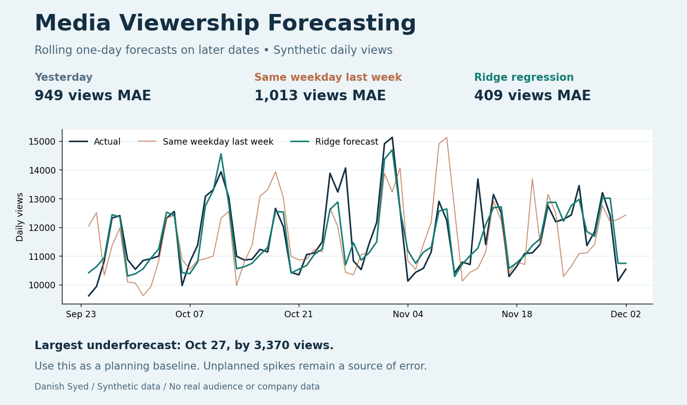

# Media Viewership Forecasting

Can a simple model forecast tomorrow's views more accurately than using yesterday's views or the same weekday last week? This portfolio case study uses synthetic daily data with a weekly cycle, gradual growth, planned promotions, and a few unplanned spikes.

## What happened on later dates

| Forecast | Mean absolute error | Root mean squared error |
|---|---:|---:|
| Yesterday's views | 949 | 1,278 |
| Same weekday last week | 1,013 | 1,343 |
| Ridge regression | **409** | **644** |

The regression reduced average absolute error by about **57%** versus yesterday's views on the 70-day test period. But on October 27 it forecast about 10,694 views against 14,064, an underforecast of **3,370 views**. The model handles regular weekly patterns and scheduled promotions better than a simple baseline in this example; it still misses events that are not in the schedule.

**Planning decision:** Use it as a baseline for next-day staffing or inventory planning in this scenario, and review the error on event days before relying on it. This is a synthetic demonstration, so the improvement does not establish performance on a real audience.

## Evaluation design

- Use 210 training days, 42 validation days, and 70 later test days after the first 14 lag warm-up days. Choose Ridge regularization on validation, refit on training plus validation, and leave the test period for evaluation.
- At each forecast, use only calendar fields, the promo flag known in advance, prior-day views, and a trailing average ending yesterday. The model weights are frozen during the test; observed views from prior test days are allowed in the next day's forecast. This is a rolling one-day forecast, not a 70-day forecast issued at once.
- MAE is the average absolute error in views. RMSE gives larger misses more weight. Signed bias in the output is forecast minus actual.

Run `pip install -r requirements.txt` then `python build.py` to regenerate the [synthetic data](synthetic_views.csv), [daily test predictions](test_forecasts.csv), [metrics](metrics.csv), and dashboard. No course dataset or real audience data is included.
