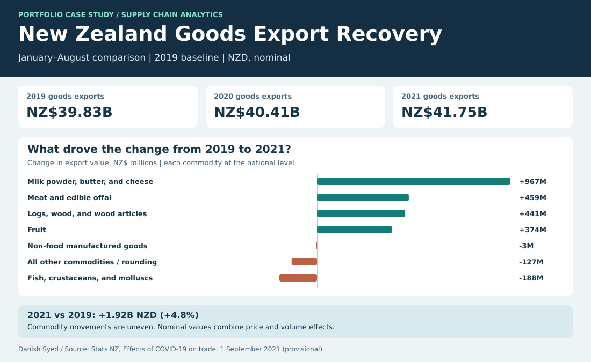

# New Zealand Goods Export Recovery

Were exports above the pre-pandemic baseline across the board, or did a few commodities explain the increase? This case study compares January–August goods exports in 2019, 2020, and 2021.

## What changed

- **NZ$41.75B in 2021**, up **NZ$1.92B (4.8%)** from 2019's NZ$39.83B. The matched 2020 period was NZ$40.41B, so the national total was already above the baseline in 2020.
- **Milk powder, butter, and cheese accounted for NZ$967M**, about half of the net increase. Meat and edible offal added NZ$459M, and logs, wood, and wood articles added NZ$441M. Fish, crustaceans, and molluscs fell NZ$188M.
- **China rose NZ$2.60B** while **Australia fell NZ$571M**. Partner series are a separate lens on the same trade and must not be added to commodity contributions. The published East Asia aggregate also overlaps with individual partners such as Japan.

## Reproduce it

Download the CSV from the [Stats NZ release](https://www.stats.govt.nz/information-releases/effects-of-covid-19-on-trade-at-1-september-2021-provisional/) and run `python3 build.py /path/to/source.csv` in this folder. The Python standard-library script runs [the SQL](analysis.sql) and regenerates [the comparison CSV](export_comparison.csv) and the dashboard. The [Power BI setup](power-bi.md) shows how to use the aggregate CSV in a report.

The SQL keeps goods exports in nominal NZ dollars, uses the all-transport series, and compares 243 days per year by omitting 29 February 2020. It sums daily values rather than cumulative values. The commodity chart uses national commodity series and a residual calculated as the national total minus the listed commodities; that residual includes other commodities and rounding. The separate national total row is the published aggregate.

Source: Stats NZ, *Effects of COVID-19 on trade: At 1 September 2021 (provisional)*. These are historical provisional estimates; the change in nominal value combines prices, volumes, and mix. The comparison does not estimate the causal effect of COVID-19.
