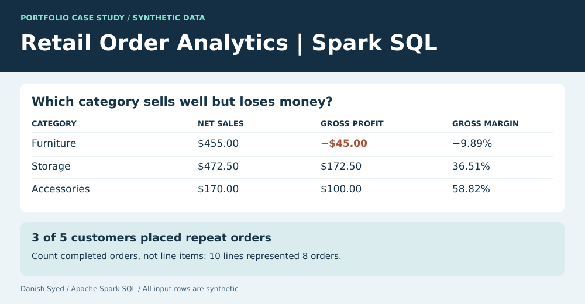

# Retail Order Analytics | Spark SQL

How can a retailer find categories that sell well but lose money, without letting multi-line orders inflate repeat-customer counts? This standalone project uses Apache Spark SQL and three synthetic CSVs.

| Category | Net sales | Gross profit | Gross margin |
|---|---:|---:|---:|
| Furniture | $455.00 | -$45.00 | -9.89% |
| Accessories | $170.00 | $100.00 | 58.82% |
| Storage | $472.50 | $172.50 | 36.51% |

Furniture had the second-highest sales but was the only category to lose money. The fixture also shows why customer metrics belong at order grain: 10 completed order lines represent eight completed orders, and only **three of five customers** made repeat purchases.

The model has one row per order in `orders.csv`, one row per product in `products.csv`, and one row per line in `lines.csv`. Spark checks keys before joining, excludes cancelled orders, calculates net sales after discount in integer cents, and aggregates category results from completed lines. The repeat-customer query counts completed order headers. Orders spanning multiple categories count once within each category, so category-level distinct order counts should not be added.

## Reproduce it

With Java 17 or 21 available, run `pip install -r requirements.txt` and `python build.py` in this directory. The script runs both [Spark SQL queries](analysis.sql) and writes the [category results](category_results.csv) and [customer results](customer_results.csv). The [dashboard](dashboard.svg) is a static view of these outputs. All inputs are invented for this case study.
