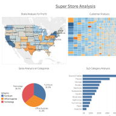
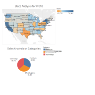

# Retail Profitability | Tableau

I built this Tableau workbook to look at where sales and profit tell different stories. The first dashboard combines a state profit map with sales by category, a customer view, and a subcategory breakdown. The second brings the state map and category sales together in a simpler view.

| Dashboard 1: Super Store Analysis | Dashboard 2: State profit and category sales |
| --- | --- |
|  |  |

These are the original 192 × 192 thumbnails saved by Tableau in my workbook. They are previews of the actual dashboards. Open the workbook for the full-size, interactive views.

## What I would investigate

- **Furniture had about $742,000 in sales but only $18,451 in profit**, a margin of about **2.5%**. It generated more sales than Office Supplies, which earned about $122,491 in profit.
- **Tables had about $207,000 in sales and lost about $17,725.** That makes Tables a better starting point than a blanket review of all Furniture.
- **Texas had the largest state loss in this sample** at about $25,729. I would drill into product mix and discount bands there before proposing a change. These are descriptive results; they do not show that discounting caused the loss.

The figures come from 9,994 order lines in the workbook's sample, using summed Sales and Profit and profit margin calculated as total Profit divided by total Sales. See the [aggregate results](profitability-summary.csv).

## Open the Tableau work

1. Download [the Tableau workbook](retail-profitability.twb).
2. Download Tableau's [Sample - Superstore.xls](https://www.tableau.com/learn/tutorials/on-demand/getting-started-part3). The workbook expects it at `Data/Tableau/Sample - Superstore.xls` relative to the workbook. If Tableau asks for the file, point the Excel connection to your local copy.
3. Open **Dashboard 1** or **Dashboard 2** in Tableau Desktop. Tableau may prompt you to update the older workbook format. Figures can differ if your sample workbook version differs from the one used here.

Data source: Tableau's [Sample Superstore](https://public.tableau.com/app/resources/sample-data), a fictitious retail dataset. The Excel file and Tableau cache are not included in this repository.
