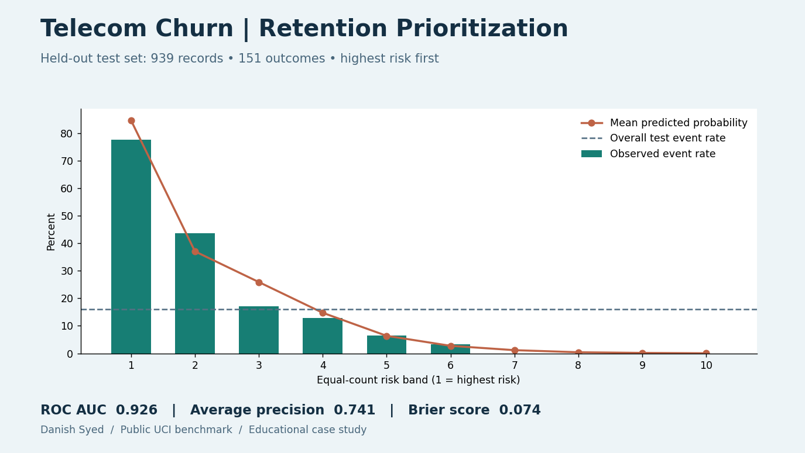

# Telecom Churn | Retention Prioritization

If a retention team can contact at most 10% of subscribers, how many future churners would a risk-ranked list capture? I built a logistic regression baseline on a public telecom dataset and evaluated the ranking on a held-out test set.

| Test set | Overall churn | Contact list | Churners captured | Churn rate on the list |
|---|---:|---:|---:|---:|
| 939 subscribers | 151 (16.1%) | Top 93 by score | 73 of 151 (48.3%) | 78.5% |

A random list of 93 would capture about 15 churners in expectation at the test-set base rate. The model achieved ROC AUC **0.926** and average precision **0.741**. The chart uses near-equal deciles, so its first band contains 94 records; the outreach calculation rounds down to 93 to stay within capacity.

UCI describes a three-month gap between the feature and label windows. The model uses usage, complaints, tariff and subscription history. It omits age fields, account status and customer value. Scaling is fitted only on the training set. Identical feature profiles are kept together to prevent them from appearing in both train and test. The split is random by profile rather than chronological, so this does not establish performance on a later cohort or at a different provider.

**Decision:** Use the ranking to define a population for a retention experiment. A high churn score does not tell you which customers will respond to an offer.

Run `pip install -r requirements.txt` and `python build.py`. The build downloads the original UCI CSV, creates a seeded grouped split with about 30% of the records held out, and regenerates [metrics](metrics.csv), [risk bands](risk_bands.csv) and the chart. The public source rows are not copied into the repository.

Data: [Iranian Churn](https://doi.org/10.24432/C5JW3Z), UCI Machine Learning Repository (2020), [CC BY 4.0](https://creativecommons.org/licenses/by/4.0/).
